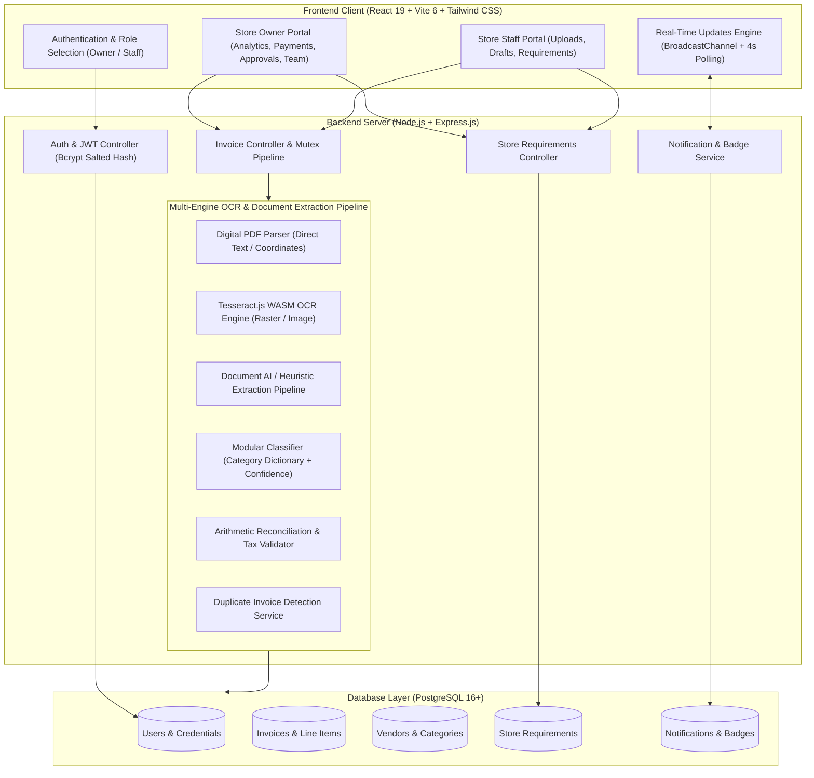
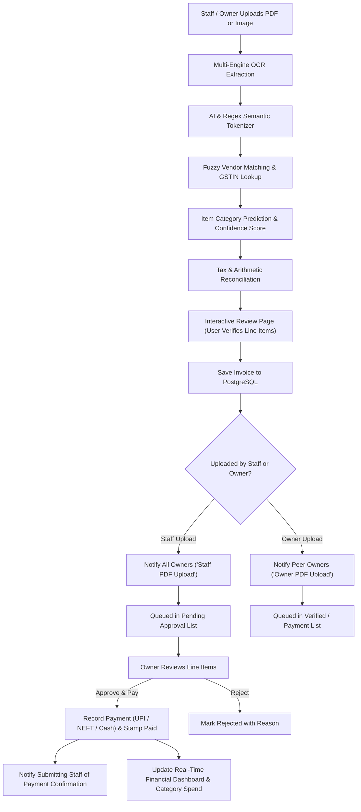
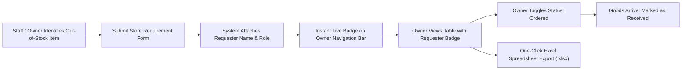
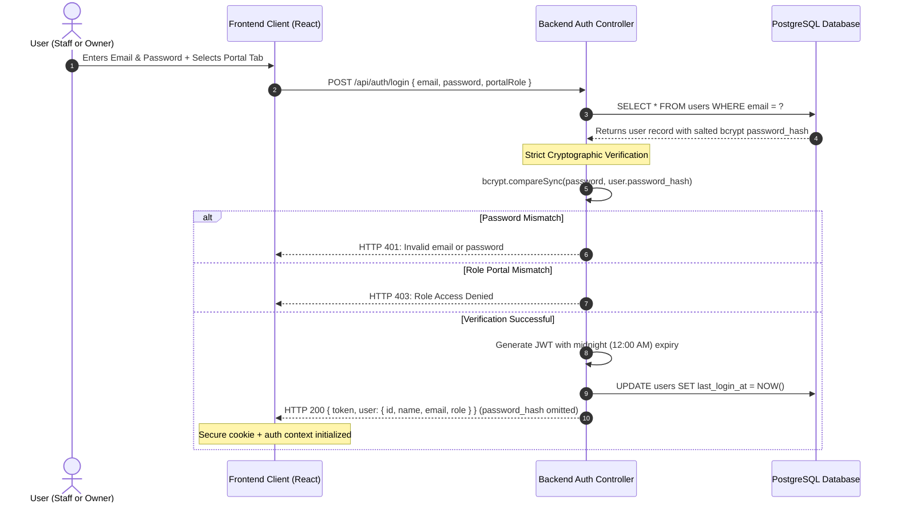

# 🧾 Quontriz Invoza - Intelligent Supermarket Invoice & Inventory System

A production-ready, full-stack **OCR Invoice Intake, Automated Item Classification, and Store Inventory Demand Management Platform** designed specifically for retail supermarkets, wholesale distributors, and multi-user store operations. 

Quontriz Invoza streamlines the entire procurement lifecycle: from supplier invoice intake (digital PDF, mobile photo, raster scan, or manual entry) and AI-powered data extraction to cross-portal owner review, payment reconciliation, inventory requirement tracking, and real-time team notifications.

---

## 📑 Table of Contents

1. [System Architecture](#-system-architecture)
2. [Role Permissions & Venn Diagram](#-role-permissions--venn-diagram)
3. [Core Feature Modules](#-core-feature-modules)
4. [Invoice Processing & Approval Workflow](#-invoice-processing--approval-workflow)
5. [Store Inventory Requirements Lifecycle](#-store-inventory-requirements-lifecycle)
6. [Security & Authentication Architecture](#-security--authentication-architecture)
7. [Technology Stack](#-technology-stack)
8. [Directory Structure](#-directory-structure)
9. [Installation & Setup](#-installation--setup)
10. [REST API Documentation](#-rest-api-documentation)

---

## 🏗️ System Architecture



---

## 🎯 Role Permissions & Venn Diagram

Quontriz Invoza enforces strict **Role-Based Access Control (RBAC)** across two primary user portals: **Store Owner** and **Store Staff**.

### Venn Diagram: Permissions & Feature Intersection

```mermaid
flowchart LR
    subgraph StaffOnly["Store Staff Portal (Operations)"]
        S1["Upload Supplier Invoices (PDF/Image)"]
        S2["Submit Manual Invoices"]
        S3["Submit Store Inventory Requirements"]
        S4["View Self-Uploaded Invoices"]
        S5["Receive Approval & Payment Alerts"]
    end

    subgraph SharedCore["Shared Intersection (Common Access)"]
        C1["Secure JWT Authentication"]
        C2["View Master Invoice Directory"]
        C3["Search, Filter & Sort Records"]
        C4["Download Clean Invoice PDFs"]
        C5["Real-Time Notification Bell & Badges"]
        C6["Self Password Management"]
    end

    subgraph OwnerOnly["Store Owner Portal (Management)"]
        O1["Financial KPIs & Analytics Charts"]
        O2["Approve & Pay Invoices (UPI/NEFT/Cash)"]
        O3["Reject Invoices with Reason"]
        O4["Team Management (Create Staff/Owners)"]
        O5["Admin Password Resets & Deletions"]
        O6["Update Requirement Status (Ordered/Received)"]
        O7["Export Requirements to Excel"]
        O8["Vendor & Category Master Control"]
    end

    StaffOnly --- SharedCore --- OwnerOnly
```



### Role Permissions Matrix

| Feature / Capability | Store Staff | Store Owner | Description |
| :--- | :---: | :---: | :--- |
| **Login & Session Management** | ✅ | ✅ | Midnight (12:00 AM) auto-expiration for security |
| **Upload Invoice (PDF / Image)** | ✅ | ✅ | Multi-format upload with automated OCR processing |
| **Manual Invoice Entry** | ✅ | ✅ | Enter line items, vendors, and taxes without physical file |
| **Submit Store Requirements** | ✅ | ✅ | Demand item, quantity, unit, specification, and priority |
| **Requester Attribution** | ✅ | ✅ | Every requirement displays the staff or owner creator name |
| **Invoice Detail & PDF Export** | ✅ | ✅ | View line items, tax breakdowns, and download clean PDFs |
| **Live Notifications & Badges** | ✅ | ✅ | Unviewed updates, upload alerts, and status changes |
| **Approve & Pay Invoices** | ❌ | ✅ | Record payment method (UPI, Bank, Cash, Cheque) & reference |
| **Reject Invoices** | ❌ | ✅ | Mark invoice as rejected with feedback |
| **Financial Analytics & Charts** | ❌ | ✅ | Spend by category, top vendors, and monthly expenditure |
| **Team Management (CRUD)** | ❌ | ✅ | Add new staff/owners, reset passwords, or remove accounts |
| **Requirement Status Toggle** | ❌ | ✅ | Quick toggle between Pending, Ordered, and Received |
| **Excel Export for Inventory** | ❌ | ✅ | Generate formatted `.xlsx` spreadsheet for procurement |
| **Vendor & Category Deletion** | ❌ | ✅ | Manage supplier profiles and product department mappings |

---

## 🌟 Core Feature Modules

### 1. Multi-Engine OCR & Document AI Intake
- **Digital PDFs**: Direct text extraction with semantic coordinate mapping.
- **Scanned & Mobile Images (`PNG`, `JPG`, `JPEG`, `WebP`)**: Pure WebAssembly **Tesseract.js OCR v5** engine runs with zero OS binary or external software dependencies.
- **Multi-Level Extraction Resilience**: Automatically extracts vendor details, GSTIN, invoice date, due date, PO number, line items, CGST/SGST/IGST, and grand totals.
- **Item Categorization**: Predicts categories (e.g., *Grocery*, *Dairy*, *Beverages*, *Electronics*, *Personal Care*) with a confidence score.

### 2. Human-in-the-Loop Side-by-Side Review
- Invoices are never committed blindly. Every extracted header, line item, unit, and tax field is presented in an interactive editor.
- **Arithmetic Reconciliation**: Auto-calculates totals, warns on tax discrepancy or round-off differences, and flags low-confidence items for review.
- **Duplicate Prevention**: Detects duplicate invoices (`Vendor + Invoice Number`) before database commit.

### 3. Store Inventory Demand Management
- Staff members can log required store stock items in seconds (e.g., `Rice - 25 KG - 10 bags`).
- **Clear Requester Attribution**: Every requirement clearly renders the author's badge (`Staff: <Name>`) so owners immediately know who submitted each request.
- **Owner Quick Status Controls**: Owners can update status directly from the table (`Pending` ➔ `Ordered` ➔ `Received`).
- **Excel Export**: Instant export to Microsoft Excel (`.xlsx`) with formatting, status badges, and timestamps.

### 4. Cross-Portal Notifications & Live Badges
- **Staff Uploads**: Instantly triggers `"New Invoice Uploaded by Staff"` across all Owner portals.
- **Owner Uploads**: Instantly triggers `"New Invoice Added by Owner"` across peer Owner portals.
- **Approval Alerts**: Staff members who uploaded the invoice receive immediate confirmation when their invoice is approved and paid.
- **Live Sync**: Uses a combination of modern browser `BroadcastChannel` (for instant zero-latency cross-tab communication) and 4-second lightweight background polling.

---

## 🔄 Invoice Processing & Approval Workflow



---

## 📦 Store Inventory Requirements Lifecycle



---

## 🔒 Security & Authentication Architecture



### Security Safeguards
1. **Salted Bcrypt Password Hashing**:
   - Every password in the database is encrypted using salted `bcrypt` with 10 salt rounds (`$2b$10$...`).
   - Plaintext passwords and fallback strings are strictly forbidden in controllers and database tables.
2. **Zero-Leak API Policy**:
   - `password_hash` and sensitive authentication secrets are strictly omitted from all JSON responses (`/users`, `/me`, `/login`, `/demo-users`).
3. **Daily Midnight Session Expiration**:
   - In accordance with retail daily shift requirements, all JWT tokens automatically expire at 12:00:00 AM midnight, enforcing fresh authentication each business day.
4. **SQL Injection Defense**:
   - All database queries utilize parameterized queries (`$1, $2, ...` or `?`).
5. **MIME & File Verification**:
   - Uploaded files are strictly validated by MIME type with strict 15MB file size limits and sanitized storage filenames.

---

## 🛠️ Technology Stack

| Domain | Technology | Version / Tooling |
| :--- | :--- | :--- |
| **Frontend Framework** | React | 19.x with Vite 6.x build tool |
| **Styling & Icons** | Tailwind CSS | 3.4 with Lucide React icons |
| **Charts & Visualizations** | Chart.js | `react-chartjs-2` for financial analytics |
| **Backend Runtime** | Node.js | v20+ / v22+ / v24+ |
| **Server Framework** | Express.js | 4.21 with native JSON & cookie parser |
| **OCR Engine** | Tesseract.js | v5 (pure WebAssembly, zero OS dependencies) |
| **Database** | PostgreSQL | 16+ (pure JS driver with connection pooling) |
| **Spreadsheet Engine** | ExcelJS | Automated formatted `.xlsx` generation |
| **Cryptography** | BcryptJS | Salted password hashing (10 rounds) |
| **Tokens & Auth** | JSON Web Tokens | `jsonwebtoken` with midnight expiry |

---

## 📂 Directory Structure

```text
Quontriz Invoza/
├── frontend/                     # React 19 + Vite 6 Frontend Application
│   ├── src/
│   │   ├── components/
│   │   │   ├── auth/            # ProtectedRoute, AuthGuard components
│   │   │   ├── layout/          # Sidebar, TopNav, App Shell
│   │   │   ├── review/          # Side-by-side reconciliation & OCR viewers
│   │   │   ├── ui/              # Badges, Modals, Tables, Spinners, Dialogs
│   │   │   └── upload/          # Drag-and-drop dropzones & step indicators
│   │   ├── context/             # AuthContext, UpdatesContext, ToastContext
│   │   ├── pages/               # DashboardPage, InvoicesPage, RequirementsPage,
│   │   │                        # InvoiceReviewPage, UsersPage, SettingsPage, etc.
│   │   ├── services/            # Axios API client modules
│   │   ├── utils/               # Formatting helpers (Currency, Date, Numbers)
│   │   ├── App.jsx              # React Router route registry
│   │   └── main.jsx             # React DOM root entry point
│   ├── index.html
│   ├── package.json
│   ├── tailwind.config.js
│   └── vite.config.js
│
├── server/                      # Express.js Backend Server
│   ├── controllers/             # authController, invoiceController,
│   │                            # requirementController, notificationController, etc.
│   ├── database/                # initPostgres.js, postgresClient.js, schema_pg.sql
│   ├── routes/                  # Express REST route endpoints
│   ├── services/                # InvoicePersistenceService, NotificationService,
│   │                            # aiInvoiceExtractor, ocrService, vendorMatcher
│   ├── uploads/                 # Uploaded invoices and test sample files
│   ├── utils/                   # authMiddleware.js, multerConfig.js, dateTime.js
│   ├── app.js                   # Main application entry point
│   ├── package.json
│   └── .env
│
├── package.json                 # Monorepo root runner (concurrently scripts)
├── README.md                    # System documentation
└── render.yaml                  # Cloud deployment configuration
```

---

## 🚀 Installation & Setup

### Prerequisites
- **Node.js**: v20 or higher (Tested and certified on Node.js v24.19)
- **npm**: v10 or higher
- **Operating System**: Windows, macOS, or Linux (zero binary dependencies required)

### Quick Start (Single Command)

1. **Clone and navigate to repository**:
   ```bash
   git clone https://github.com/KornipatiAkash-1969/quontriz-invoza.git
   cd quontriz-invoza
   ```

2. **Install all dependencies**:
   ```bash
   npm run install:all
   ```

3. **Start both Backend and Frontend concurrently**:
   ```bash
   npm run dev
   ```

4. **Access the application**:
   - **Frontend App**: [http://localhost:5173](http://localhost:5173)
   - **Backend API**: [http://localhost:5000](http://localhost:5000)
   - **API Health Check**: [http://localhost:5000/api/health](http://localhost:5000/api/health)

---

## 📡 REST API Documentation

### Authentication & Users

| Method | Endpoint | Access | Description |
| :--- | :--- | :---: | :--- |
| `POST` | `/api/auth/login` | Public | Direct email + password authentication |
| `POST` | `/api/auth/logout` | Public | Clears session cookie and authorization state |
| `GET` | `/api/auth/me` | Authenticated | Fetch current authenticated user profile |
| `GET` | `/api/auth/users` | Owner Only | List team users (strictly omits password hashes) |
| `POST` | `/api/auth/users` | Owner Only | Create new Staff or Owner account |
| `PUT` | `/api/auth/users/:id/password` | Owner Only | Admin password reset for team member |
| `DELETE` | `/api/auth/users/:id` | Owner Only | Delete user and safely disassociate foreign keys |
| `POST` | `/api/auth/change-password` | All Users | Change own password |

### Invoices & Procurement

| Method | Endpoint | Access | Description |
| :--- | :--- | :---: | :--- |
| `POST` | `/api/invoices/upload` | All Users | Upload invoice file and run multi-engine OCR pipeline |
| `POST` | `/api/invoices/process-sample/:key` | All Users | Instant OCR test using built-in grocery/electronics samples |
| `POST` | `/api/invoices` | All Users | Persist confirmed invoice with line items and vendor |
| `GET` | `/api/invoices` | All Users | Filtered, sorted, and paginated invoice directory |
| `GET` | `/api/invoices/:id` | All Users | Fetch complete invoice details, line items, and audit trail |
| `POST` | `/api/invoices/:id/approve-pay` | Owner Only | Approve invoice and record payment details |
| `POST` | `/api/invoices/:id/reject` | Owner Only | Reject invoice with note |
| `GET` | `/api/invoices/:id/pdf` | All Users | Download clean rendered Invoice PDF |
| `DELETE` | `/api/invoices/:id` | Owner Only | Delete invoice record |

### Store Requirements

| Method | Endpoint | Access | Description |
| :--- | :--- | :---: | :--- |
| `GET` | `/api/requirements` | All Users | List store requirements with requester attribution |
| `POST` | `/api/requirements` | All Users | Create new store demand requirement |
| `PUT` | `/api/requirements/:id` | All Users | Update requirement details or toggle status |
| `GET` | `/api/requirements/export/excel` | Owner Only | Download formatted Excel inventory spreadsheet |
| `DELETE` | `/api/requirements/:id` | Owner Only | Delete store requirement |

### Notifications & Live Badges

| Method | Endpoint | Access | Description |
| :--- | :--- | :---: | :--- |
| `GET` | `/api/notifications/updates` | All Users | Real-time badge counts for navigation bar & sidebar |
| `GET` | `/api/notifications` | All Users | Paginated list of persistent notification records |
| `POST` | `/api/notifications/mark-all-read` | All Users | Mark all persistent notifications as read |
| `POST` | `/api/notifications/:id/read` | All Users | Mark single notification as read |

---

## 📄 License
ISC License. Built for Supermarket & Retail Enterprise Invoicing.
